```{r setup, include=FALSE}
# Knit this file from the repository root so that figures/ and artifacts/ resolve.
knitr::opts_chunk$set(echo = FALSE, message = FALSE, warning = FALSE)
library(knitr)
art <- function(f) read.csv(file.path("artifacts", f), check.names = FALSE,
                            stringsAsFactors = FALSE, fileEncoding = "UTF-8")
```

**Code, notebook and results:** <`r params$repo_url`>

# Abstract

A neural fault detector trained on known failure modes can respond to a new, unseen fault with a confident but wrong diagnosis, leaving the machine at full speed. The obvious remedy, stopping the machine whenever the model is unsure, avoids that risk but costs production. This report asks a more modest question than fault identification: when the system does not know what is wrong, can it fail safely instead of failing badly?

We use the public CWRU bearing dataset. A 1D convolutional network is trained on seven known conditions at 1 hp, and two fault classes (IR021 and B021) are held out as unseen faults. A logit-margin uncertainty score, averaged over five consecutive windows (0.26 s) and compared with a threshold chosen only from known validation data, decides whether a diagnosis is trusted. Machine capacity is set by a separate physics envelope: a continuous function of vibration velocity, referenced to ISO 10816-1 Class I boundaries, that does not depend on the network. Four policies are compared at 1 hp and at 2 hp, a load the network never saw in training.

With the network alone, 100.0% of unseen-fault decision steps are silent misdiagnoses. Stopping on every uncertain prediction removes them but causes 61.5% downtime at 1 hp and 42.0% at 2 hp. The final design, in which the physics envelope alone sets capacity and the network supplies only the diagnosis, produced 0.0% silent failures and 0.0% downtime in the main run. Single networks varied across training seeds (unseen-fault detection 87.9 ± 12.7%, worst seed 65.7%); a five-network ensemble reached 96.8%. Three limitations matter: the uncertainty score is also sensitive to load change (27.9% of correctly classified 2 hp windows were flagged), real recordings stayed in ISO Zone A so the derating and stopping behaviour is shown only by fault injection, and all results come from one dataset and one test rig.

# 1. Introduction

## 1.1 Problem and motivation

Data-driven fault detectors recognise the fault types present in their training data. A new fault is outside that experience, and a neural classifier has no built-in way to say \"none of the above\": it still assigns the input to the closest known class, often with high confidence. Two failures follow. In the first, the machine keeps running at full speed under a misdiagnosed fault, damage grows, and the line eventually stops without warning. In the second, the system avoids that risk by stopping whenever it is unsure, and the plant loses production even when the machine could have run safely at reduced capacity.

A large body of work responds by trying to identify the unseen fault, for example with zero-shot diagnosis that relies on semantic attributes or generated data. That is difficult to satisfy for faults that have not happened yet. Our aim is different and narrower: keep the machine safe even when the fault cannot be named.

## 1.2 Research question

*Can an uncertainty-triggered, physics-constrained fallback layer keep a machine in safe degraded operation when it faces a fault type never seen in training, without trying to diagnose that fault?*

In plain terms, the question is not whether every possible fault can be detected, but whether the system can still fail safely when it is confused.

## 1.3 Approach and contributions

The final design separates two jobs that are often combined. The physics envelope controls how much the machine may run, using only measured vibration velocity and published severity boundaries. The neural network supplies the diagnosis and, through its uncertainty score, tells the operator when that diagnosis should not be trusted. The contributions of this work are:

-   **A design that separates capacity control from diagnosis**, so a confusing or novel fault cannot change how much the machine is allowed to run.

-   **An evaluation of uncertainty triggers** (softmax confidence, logit margin, multi-window aggregation, and a five-network ensemble) with the threshold chosen from known validation data only.

-   **A four-policy comparison** at 1 hp and 2 hp using explicit metrics, including silent failure and downtime, plus fault injection to exercise ISO zones that the real recordings never reached.

-   **Reporting of limitations as findings**: load sensitivity of the uncertainty score, the fact that real data stayed in Zone A, and the variation between training seeds.

# 2. Literature Review and Gap Analysis

We reviewed ten recent papers and grouped them into three bodies of work: zero-shot fault diagnosis, physics-informed and uncertainty-aware diagnosis, and runtime assurance. The summaries below are based on the published abstracts and descriptions of each work; they are not an exhaustive survey.

## 2.1 Zero-shot fault diagnosis

Zero-shot fault diagnosis tries to classify faults for which no training samples exist. Mu et al. \[1\] build a physical-knowledge-guided generative model for process faults and report about 11% higher accuracy on unseen faults than traditional zero-shot baselines. Cen et al. \[2\] use a generative generalised zero-shot model that synthesises features of unseen compound bearing faults and matches them to generated semantic vectors. Huang et al. \[3\] use a prototypical vision transformer to recognise unseen bearing faults under varying speeds and loads without fine-tuning the backbone. Yang and Sun \[4\] project frequency-domain features into a semantic space with a semantic autoencoder to diagnose bearing faults under unknown working conditions, validated on the CWRU and MFPT datasets.

These works share an assumption: the unseen fault can be identified, usually through human-defined fault attributes or synthetic data for fault types that have not yet occurred. Their output is a class label. None proposes what the machine should do while the fault remains unclassified.

## 2.2 Physics-informed and uncertainty-aware diagnosis

Physics has been used to improve diagnosis in several ways. Qin et al. \[5\] use an inverse physics-informed network and a digital twin to generate fault samples when data are imbalanced. Shen et al. \[6\] combine a physics-based threshold model with a CNN and a physics-informed loss, validated on field bearings and on CWRU data. Xu et al. \[7\] add physical constraints to a probabilistic network to obtain calibrated uncertainty. In these works physics acts offline, in data generation or training, or inside the diagnostic model, not as a runtime safety rule.

Uncertainty estimation has been used to detect unseen faults directly. Han and Li \[8\] use uncertainty-aware deep ensembles for out-of-distribution detection and report strong detection while keeping accuracy on known faults. Zeng et al. \[9\] decompose uncertainty into data and model parts so that sensor noise is not mistaken for a new fault. Both stop at flagging: mitigation is left to a human operator.

## 2.3 Runtime assurance and safety-preserving control

The Simplex family of architectures guarantees safety at run time by switching from an unverified advanced controller to a verified baseline controller when a safety envelope would be violated. Sheikhi et al. \[10\] present a black-box version that needs no internal model of the advanced controller and supports blending for smoother transfer. It is demonstrated on autonomous multi-agent and aircraft simulations, not on industrial fault degradation with vibration limits. We also borrow the general idea of correcting smoothly as a safety boundary is approached rather than acting only at the boundary \[13\]; we do not claim the formal guarantees of that literature.

## 2.4 Literature matrix

**Table 1.** Summary of reviewed work against the problem studied here.

| **Ref.**      | **Approach**                                                      | **Unseen faults**            | **Uses uncertainty** | **Action on an unseen fault**                                                  | **Limitation for this problem**  |
|-------|---------------|---------|----------|----------------|------------------|
| \[1\]         | Physical-knowledge generative zero-shot learning (process faults) | Classifies                   | No                   | Outputs a class label                                                          | Stops at diagnosis               |
| \[2\]         | Generative zero-shot learning, compound bearing faults            | Classifies                   | No                   | Outputs a class label                                                          | No runtime action                |
| \[3\]         | Prototypical vision transformer, varying conditions               | Classifies                   | No                   | Outputs a class label                                                          | No control loop                  |
| \[4\]         | Semantic-autoencoder zero-shot learning, unknown working conditions                          | Classifies                   | No                   | Outputs a class label                                                          | Diagnosis only                   |
| \[5\]         | Inverse PINN and digital twin                                     | Indirect                     | No                   | Generates training data offline                                                | Physics not used at runtime      |
| \[6\]         | Physics threshold model with CNN                                  | Known distributions          | No                   | Detection                                                                      | No fallback for unknown faults   |
| \[7\]         | Physics-informed probabilistic network                            | Partly                       | Yes                  | Diagnosis with confidence                                                      | No automatic response            |
| \[8\]         | Uncertainty-aware deep ensembles, OOD detection                   | Flags                        | Yes                  | Warning to operator                                                            | Mitigation left to humans        |
| \[9\]         | Uncertainty decomposition for OOD detection                       | Flags                        | Yes                  | Flags OOD                                                                      | No control authority             |
| \[10\]        | Black-box Simplex runtime assurance                               | Not applicable               | No                   | Switches to safe controller                                                    | Not applied to industrial faults |
| **This work** | **CNN diagnosis plus independent physics envelope**               | **Does not classify; flags** | **Yes**              | **Physics envelope sets capacity; diagnosis reported as \"unknown, inspect\"** | **One dataset, one rig**         |

## 2.5 Gap analysis

Three observations follow from the matrix.

1.  Zero-shot diagnosis \[1-4\] names the unseen fault. It needs attributes or generated data for faults that have not occurred, and it provides no operating policy for the period in which the fault is unclassified.

2.  Uncertainty-aware and physics-informed work \[5-9\] shows that unseen faults can be detected and that physics improves diagnosis, but the response is left to a human operator, and physics is used offline or inside the model.

3.  Runtime assurance \[10\] provides the switching pattern but has not, in the sources reviewed, been adapted to industrial fault tolerance with continuous vibration limits.

**Gap.** Within the sources we reviewed, we did not find work that combines an uncertainty-aware detector of unseen faults with an independent, standard-referenced physics rule that governs machine capacity, evaluated for silent failure and downtime. This report addresses that combination on a public benchmark. It does so with one difference from the Simplex pattern: our final design does not switch to the physics controller only when the network is uncertain. The physics envelope is always active (Section 5.8 explains why).

# 3. Dataset and Experimental Setup

## 3.1 CWRU bearing dataset

We use the Case Western Reserve University Bearing Data Center dataset \[11\], a widely used benchmark of vibration recordings from a motor test rig with seeded single-point bearing faults \[16\]. We use the drive-end accelerometer at 12 kHz. Faults are inner race (IR), outer race (OR, sensor position centred at 6 o\'clock) and ball (B), at seeded diameters of 0.007, 0.014 and 0.021 inch. Normal recordings serve as the healthy class. The 1 hp recordings are the primary data. Recordings at 2 hp are used only as a control for load change: they never enter training or threshold selection.

**Table 2.** Class design and role of each class.

| **Class** | **Fault family** | **Diameter (in)** | **Role**          | **1 hp windows** |
|-----------|----------------|------------|------------------|----------------|
| Normal    | Healthy          | \-                | Known             | 235              |
| IR007     | Inner race       | 0.007             | Known             | 237              |
| IR014     | Inner race       | 0.014             | Known             | 236              |
| OR007     | Outer race       | 0.007             | Known             | 238              |
| OR014     | Outer race       | 0.014             | Known             | 237              |
| B007      | Ball             | 0.007             | Known             | 236              |
| B014      | Ball             | 0.014             | Known             | 237              |
| IR021     | Inner race       | 0.021             | Unseen (held out) | 236              |
| B021      | Ball             | 0.021             | Unseen (held out) | 236              |

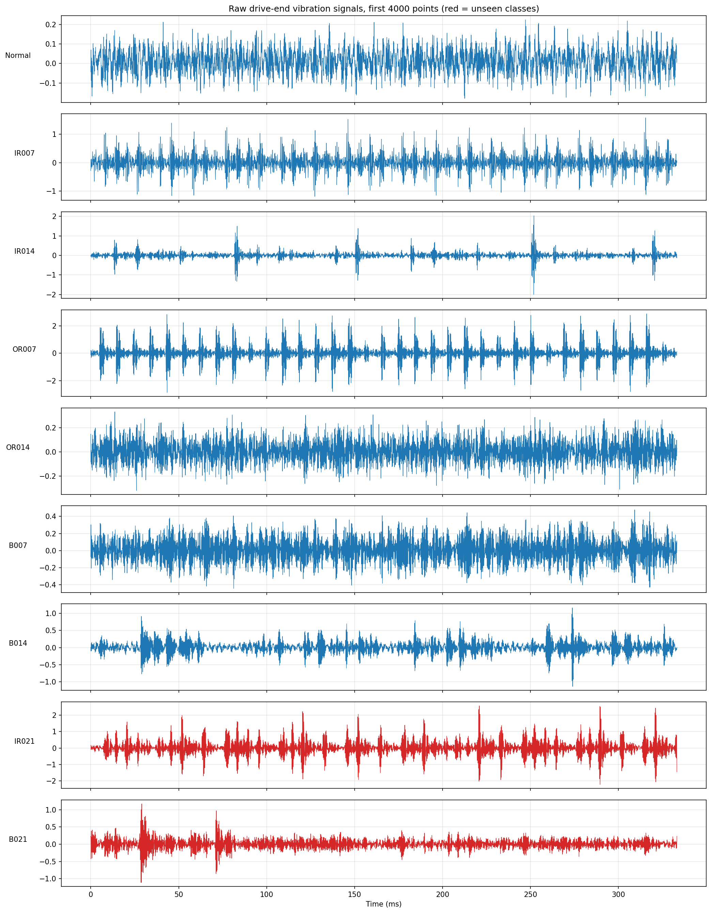{width=90%}

**Figure 1.** Raw drive-end vibration signals (first 4000 points) for the seven known classes and the two unseen classes (red).

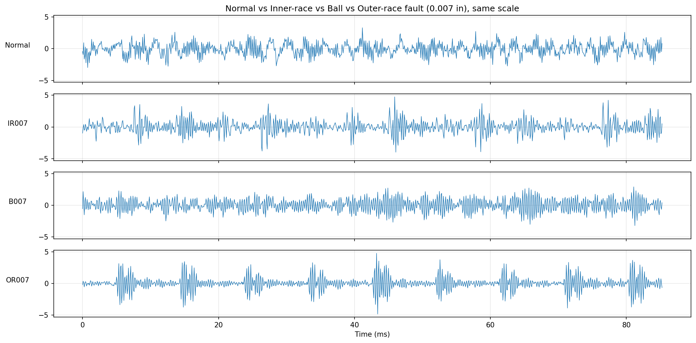{width=90%}

**Figure 2.** Normal, inner-race, ball and outer-race signals at 0.007 in on the same scale, over one 85 ms window length. The fault families differ in impulse pattern and amplitude.

## 3.2 Preprocessing and split

Each recording is cut into windows of 1024 points (about 85 ms at 12 kHz) with a stride of 512 points (50% overlap) and z-score normalised per window. Because overlapping windows share half their samples, a random split would leak information from training into testing. We therefore use a blocked, time-separated split: training, validation and test windows come from different contiguous blocks of each recording, and we verified that no window overlaps across sets. The split gives 1189 training, 133 validation and 320 test windows for the known classes (45 to 46 test windows per class), and 472 windows for the two unseen classes.

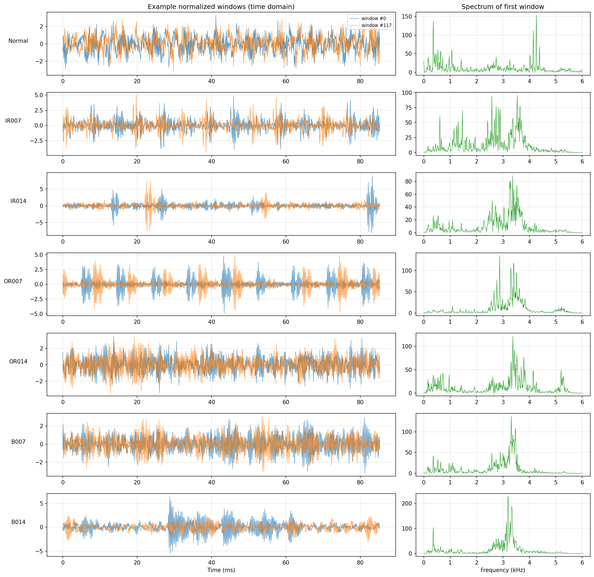{width=90%}

**Figure 3.** Example normalised windows (two per class, in blue and orange) and the spectrum of the first window for each known class.

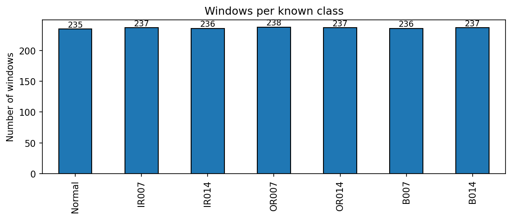{width=90%}

**Figure 4.** Windows per known class (235 to 238), showing a balanced dataset.

## 3.3 Decision steps

For the evaluation of policies, the system makes a decision at every window once five windows are available. A decision step uses the five most recent windows (1024 + 4 x 512 = 3072 samples, 0.26 s): the mean logit margin, the majority-vote prediction, and the RMS vibration velocity over the last 1 s of signal. Steps are advanced one window at a time and kept in time order.

# 4. System Design and Methodology

## 4.1 Overview

Figure 5 shows the final design. Two paths run in parallel from the same signal. The neural path classifies the window and scores how much the prediction can be trusted. The physics path converts acceleration to velocity and maps it to an allowed capacity. The two paths are not merged: the capacity command comes from the physics path alone, and the neural path produces the diagnosis report. A prediction whose averaged margin falls below the threshold is reported as \"unknown condition, inspect\" instead of a fault label.

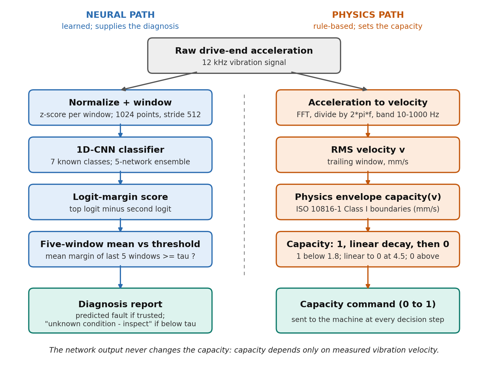{width=90%}

**Figure 5.** Final system design. The neural path supplies the diagnosis and a trust flag; the physics path alone sets the capacity command.

## 4.2 Neural fault detector

The classifier is a 1D convolutional network. The first layer is a wide convolution (16 filters, kernel 64, stride 8) followed by batch normalisation, ReLU and max pooling; three further blocks (32, 64 and 64 filters, kernel 3) follow with the same normalisation, activation and pooling. Global average pooling feeds a dense layer of 100 units, dropout of 0.3, and a softmax output over the seven known classes.

**Table 3.** Network and training settings.

| **Item**  | **Setting**                                                                                                                                                                    |
|---------------|---------------------------------------------------------|
| Input     | 1024-point normalised window, one channel                                                                                                                                      |
| Optimiser | Adam, learning rate 1e-3                                                                                                                                                       |
| Loss      | Sparse categorical cross-entropy with inverse-frequency class weights                                                                                                          |
| Training  | Batch size 32, up to 50 epochs; early stopping on validation loss (patience 12, best weights restored); learning rate halved after 5 epochs without improvement (minimum 1e-5) |
| Seeds     | 42 (main run); 42, 7, 123, 2024 and 31337 for the five-seed study                                                                                                              |
| Baseline  | Random Forest on hand-crafted features                                                                                                                                         |

## 4.3 Uncertainty scores and trigger

We examine two scores. **Softmax confidence** is the largest softmax probability. **Logit margin** is the difference between the largest and second-largest logit, which does not saturate near a fixed value. For both, the threshold tau is chosen from the known validation windows only, so that 95% of known validation windows are accepted; no unseen-fault data and no 2 hp data are used. A prediction is flagged as uncertain when its score is below tau. To reduce the effect of single noisy windows, the logit margin is averaged over K = 5 consecutive windows (0.26 s) before it is compared with tau.

A **deep ensemble** of the five single networks averages their predicted probabilities \[14\]. The ensemble logits are the logarithm of the averaged probabilities, so the same margin score and threshold rule apply unchanged.

## 4.4 Physics envelope

CWRU provides acceleration, while ISO vibration severity is expressed as velocity RMS. We convert acceleration to velocity in the frequency domain by dividing each component by 2 pi f and keeping the 10 to 1000 Hz band; the conversion was checked against synthetic sinusoids of known frequency (relative error below 1%). The severity zones follow the ISO 10816-1 Class I reference values for small machines \[12\]. The CWRU motor (about 1.5 kW) is below the 15 kW scope of ISO 10816-3, so these values are an engineering reference, not a certified acceptance criterion for this motor.

**Table 4.** Velocity zones used by the physics envelope (velocity RMS, 10 to 1000 Hz).

| **Zone** | **Velocity (mm/s)** | **Meaning**                          | **Allowed capacity**       |
|--------|----------------|----------------------------|---------------------|
| A        | below 0.71          | Newly commissioned condition         | 1.0                        |
| B        | 0.71 to 1.8         | Acceptable for long-term operation   | 1.0                        |
| C        | 1.8 to 4.5          | Not suitable for long-term operation | Falls linearly from 1 to 0 |
| D        | 4.5 and above       | Dangerous                            | 0 (stop)                   |

The capacity is a continuous function of the velocity v (in mm/s), with breakpoints taken from the zone boundaries and no hand-chosen percentages:

*capacity(v) = 1, for v \< 1.8*

*capacity(v) = 1 - (v - 1.8) / (4.5 - 1.8), for 1.8 \<= v \< 4.5*

*capacity(v) = 0, for v \>= 4.5, or for an invalid (non-numeric or negative) reading*

An invalid reading returns zero capacity, so the function fails safe. The function reads only the measured velocity and never the network output.

## 4.5 Policies compared

**Table 5.** The four policies. The network and trigger are identical across policies; only the use of the output differs.

| **Policy**                              | **Capacity rule**                                                  | **Diagnosis**                                          |
|---------------------|-----------------------------|----------------------|
| NN only (no fallback)                   | Always 1.0                                                         | Network prediction, never flagged                      |
| Hard stop on uncertainty                | 0 when uncertain or in Zone D; otherwise 1.0                       | Prediction, or flagged when uncertain                  |
| Graceful (Simplex switch)               | 0 in Zone D; 1.0 while trusted; physics capacity(v) when uncertain | Prediction, or flagged when uncertain                  |
| **Graceful + physics envelope (final)** | **capacity(v) at all times**                                       | **Prediction, or \"unknown, inspect\" when uncertain** |

## 4.6 Metrics

All metrics are computed over decision steps.

-   **Silent failure**: the network is wrong, the step is not flagged, and capacity is 1.0 (a wrong diagnosis with no warning at full capacity).

-   **Downtime**: share of steps at capacity 0. **Availability**: mean capacity.

-   **Unsafe operation**: capacity above 0 while the velocity is in Zone D.

-   **Unnecessary stop**: capacity 0 outside Zone D.

-   **False fallback**: the trigger fires although the network was correct (known classes only).

-   **Safe operation**: share of steps with neither unsafe operation nor silent failure.

Downtime for a load is pooled over all decision steps at that load (known and unseen). Silent failure and safe operation for unseen faults are reported on the unseen 1 hp steps.

# 5. Results

## 5.1 The base model works on known faults

The network classifies all seven known conditions at 1 hp with 100.0% accuracy on the 320-window test set (95% Wilson lower confidence bound 98.9% \[15\]), matching the Random Forest baseline on hand-crafted features (100.0%). Trained only at 1 hp, it also classifies the known classes at 2 hp with 100.0% accuracy. Across five independently trained networks, test accuracy was 100.0 ± 0.0%. The task is easy at 1 hp for known classes, so the interest lies in unseen faults and load change.

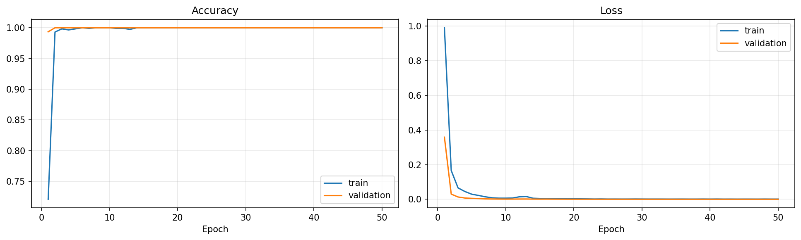{width=90%}

**Figure 6.** Training and validation accuracy (left) and loss (right) over 50 epochs for the main run.

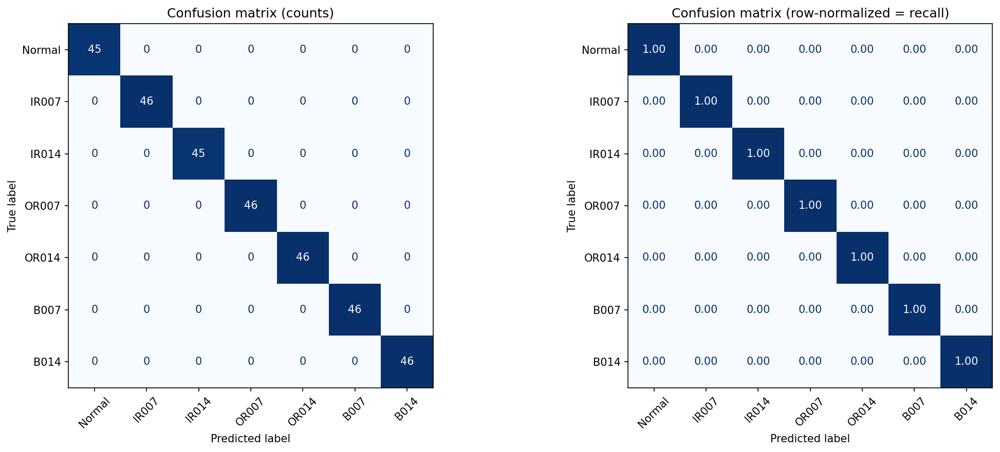{width=90%}

**Figure 7.** Confusion matrix on the known-class test set: counts (left) and row-normalised recall (right). Every class is classified correctly.

## 5.2 Uncertainty separates known from unseen faults, but softmax is overconfident

Mean softmax confidence is 0.9999 on known windows and 0.8186 on unseen windows: the network remains highly confident on fault sizes it has never seen. Figure 8 shows why. IR021 windows have broadly spread confidence, but B021 windows are almost as confident as known ones. The ranking still separates the two groups well (AUROC 0.994). With the threshold set from known validation data only (tau = 0.9998), 5.9% of known and 98.7% of unseen windows are flagged. The threshold is extremely close to 1 because the softmax is saturated.

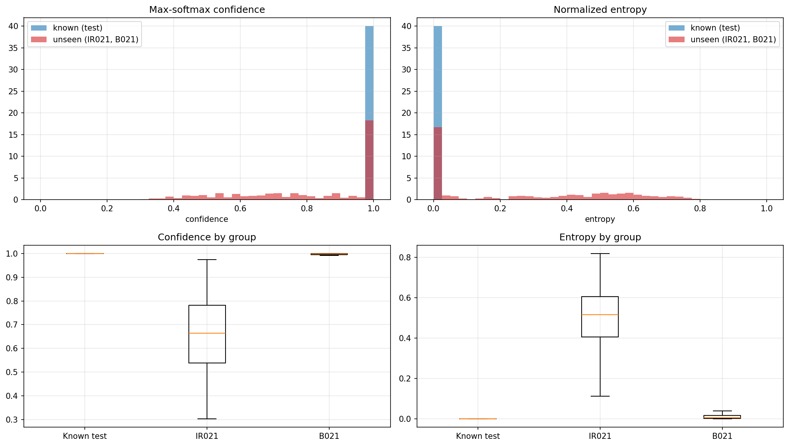{width=90%}

**Figure 8.** Softmax confidence and normalised entropy for known test windows and the unseen classes, as histograms (top) and by group (bottom).

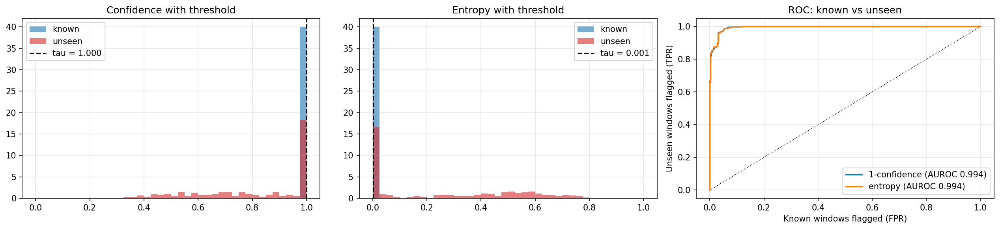{width=90%}

**Figure 9.** Threshold selection from known validation data (left, middle) and the ROC curve of known versus unseen windows (right).

## 5.3 Logit margin with five-window aggregation is the better trigger

The logit margin carries the same ranking information (AUROC 0.991; tau = 9.14) without saturation. At this threshold, 5.6% of known windows (95% CI 3.4 to 8.7%) and 98.1% of unseen windows (95% CI 96.4 to 99.1%) are flagged. Averaging the margin over five consecutive windows reduces known-fault flags to 0.3% and raises unseen-fault flags to 100.0%. Softmax confidence cannot be averaged in the same way: its saturation lets single outliers dominate the mean (known 2 hp flags rise from 27.3% per window to 39.8% after aggregation).

**Table 6.** Uncertainty triggers at the threshold chosen from known validation data (main run).

| **Score**                       | **AUROC** | **Threshold** | **Known flagged** | **Unseen flagged** |
|------------------------|----------|-----------|--------------|---------------|
| Softmax confidence, 1 window    | 0.994     | 0.9998        | 5.9%              | 98.7%              |
| Logit margin, 1 window          | 0.991     | 9.14          | 5.6%              | 98.1%              |
| Logit margin, mean of 5 windows | \-        | 9.14          | 0.3%              | 100.0%             |

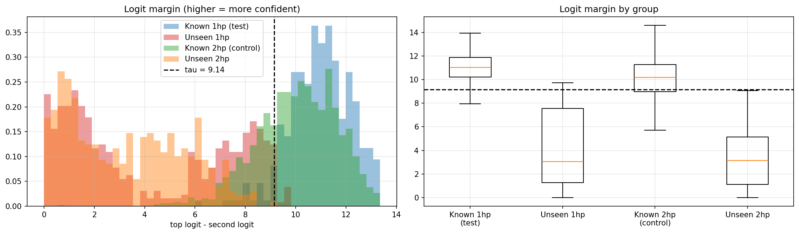{width=90%}

**Figure 10.** Logit margin for known and unseen windows at 1 hp and at 2 hp, as histograms (left) and by group (right). The dashed line is the threshold (9.14).

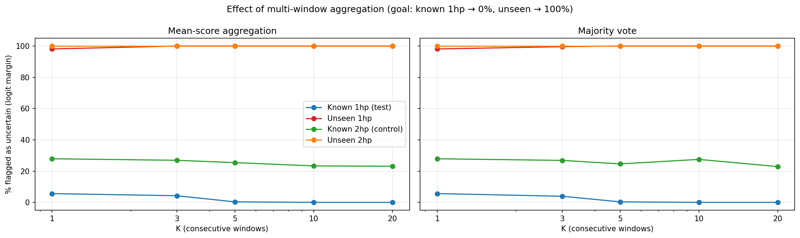{width=90%}

**Figure 11.** Percentage flagged as uncertain against the number of aggregated windows K, for mean-score aggregation (left) and majority vote (right).

## 5.4 Seed variation and the ensemble

Single networks differ from one training run to the next. Over five seeds the logit margin flagged 4.5 ± 1.3% of known and 87.9 ± 12.7% of unseen windows (range 65.7% to 98.1%), and 91.5 ± 15.3% of unseen windows with five-window aggregation. The weakest seed (7) flagged only 65.7% of unseen windows, because it flagged only 31.4% of B021 windows and called almost all missed ones B007 (99%). A deep ensemble of the five networks flagged 96.8% of unseen and 6.2% of known windows, so it removes dependence on one lucky or unlucky seed. The ensemble does not remove load sensitivity: its false fallback rate on known 2 hp steps is 30.2%, higher than the single-network average (14.1 ± 8.8%).

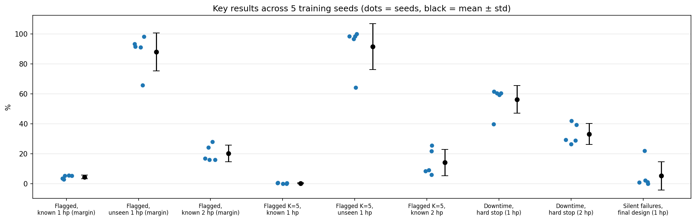{width=90%}

**Figure 12.** Key results across five training seeds (dots) with mean ± standard deviation (black).

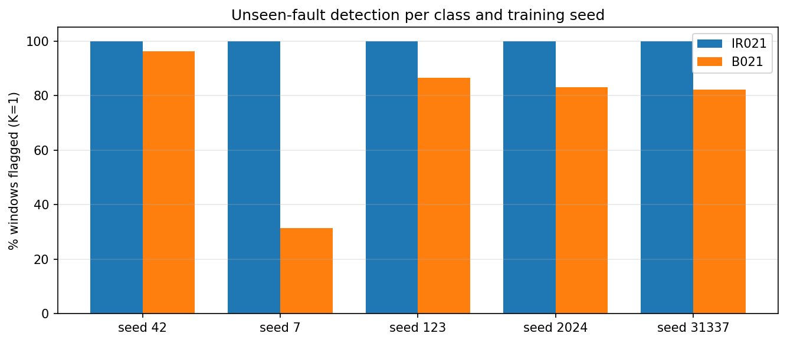{width=90%}

**Figure 13.** Unseen-fault detection per class and training seed (K = 1). B021 is the weak class, and seed 7 is the weakest seed.

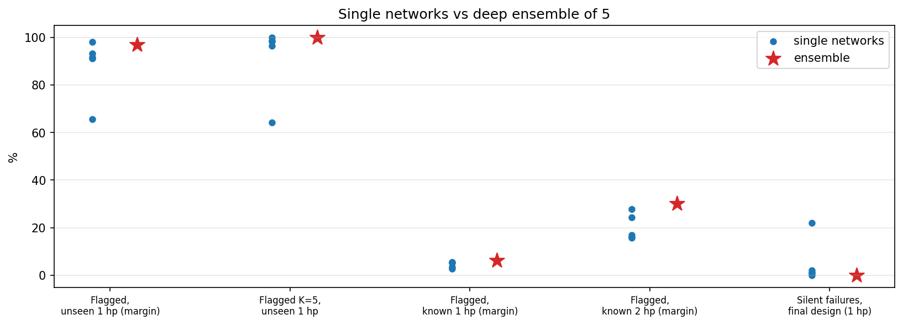{width=90%}

**Figure 14.** Single networks (blue) compared with the five-network ensemble (red star) on five measures.

## 5.5 Load sensitivity of the uncertainty score

At 2 hp, 27.9% of known-class windows are flagged although all are classified correctly (AUROC against known 1 hp test windows 0.676, where 0.5 would mean no load sensitivity). On a scale from known (0) to unseen (1), the 2 hp control sits at 0.24: the score is driven mainly by fault novelty but is also sensitive to operating conditions. The effect is systematic rather than noise: 27.9% of 2 hp windows are flagged at K = 1 and still 23.1% at K = 20. Across seeds, 20.2 ± 5.5% are flagged (control position 0.19 ± 0.05).

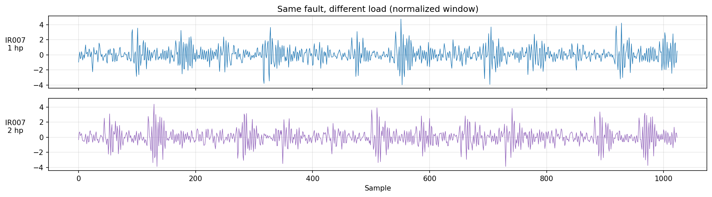{width=90%}

**Figure 15.** The same fault (IR007) at 1 hp and 2 hp, as normalised windows.

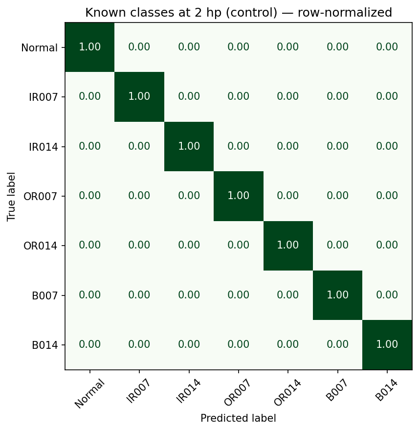{width=90%}

**Figure 16.** Row-normalised confusion matrix for the known classes at 2 hp: classification stays at 100% although the uncertainty score is shifted.

## 5.6 Physics envelope on the recordings

On the CWRU rig, ISO velocity (10 to 1000 Hz) stays in Zone A for every condition (0.14 to 0.29 mm/s; the A/B boundary is 0.71 mm/s). Velocity RMS does not rise with fault size in these data (for example IR014 is below IR007), so the broadband velocity measure does not separate the seeded bearing faults. The physics layer therefore judged all recordings mechanically safe and returned full capacity. Its behaviour in Zones C and D could only be examined with the function tests and fault injection below.

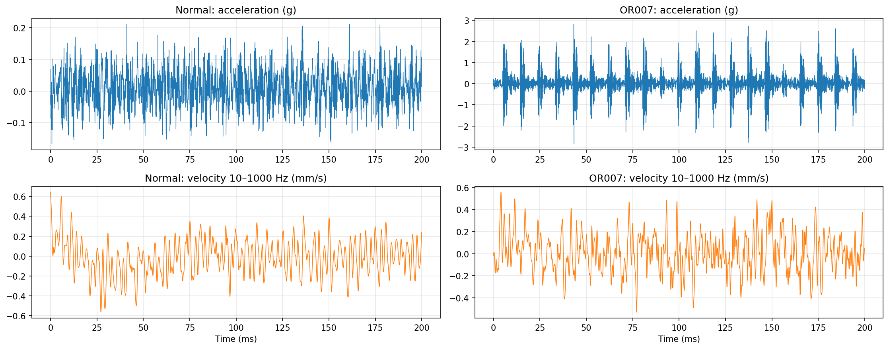{width=90%}

**Figure 17.** Acceleration (top) and band-limited velocity (bottom) for a Normal and an OR007 recording (first 200 ms).

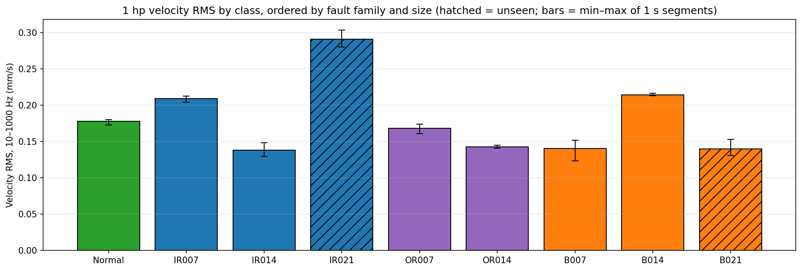{width=90%}

**Figure 18.** Velocity RMS at 1 hp by class (hatched bars are unseen classes; error bars show the min to max of 1 s segments).

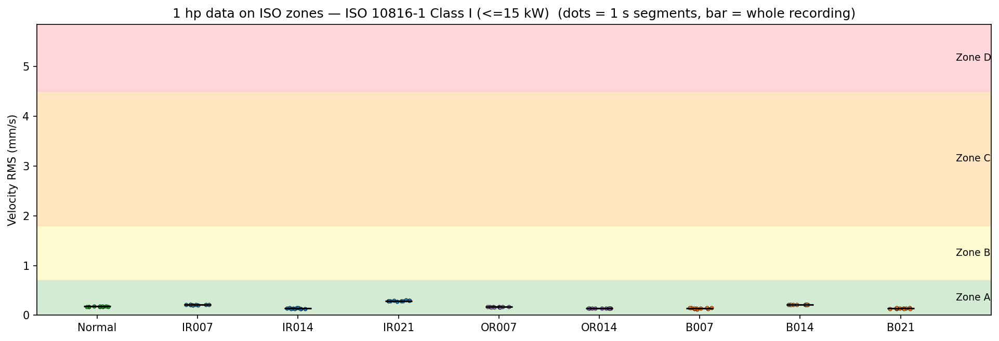{width=90%}

**Figure 19.** The 1 hp velocity values on the ISO 10816-1 Class I zones. All classes lie in Zone A.

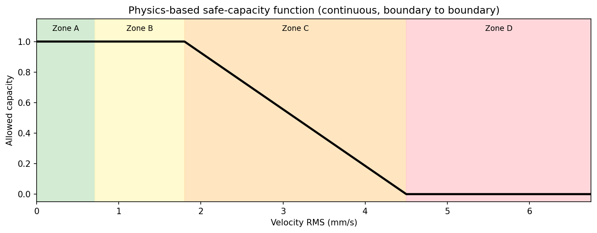{width=90%}

**Figure 20.** The physics-based capacity function: 1 up to the B/C boundary, a linear decrease through Zone C, and 0 from the C/D boundary.

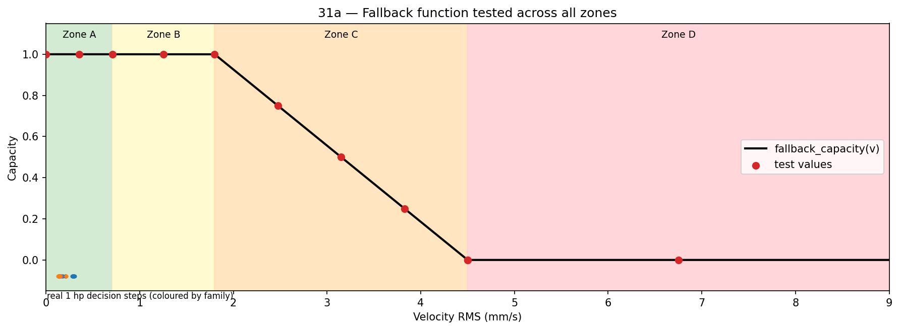{width=90%}

**Figure 21.** Function tests across all zones (red points). Real 1 hp decision steps (small dots at the left) all sit in Zone A.

We also shifted both breakpoints by up to 20% and found no change in availability, unsafe operation or silent failure. This result is flat because real data never left Zone A, so it shows only that the real-data results do not depend on the exact boundaries; it is not evidence of robustness in Zones C and D.

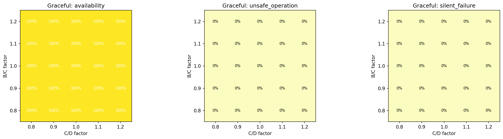{width=90%}

**Figure 22.** Sensitivity of the graceful policy (availability, unsafe operation, silent failure) to the B/C and C/D boundary factors (0.8 to 1.2).

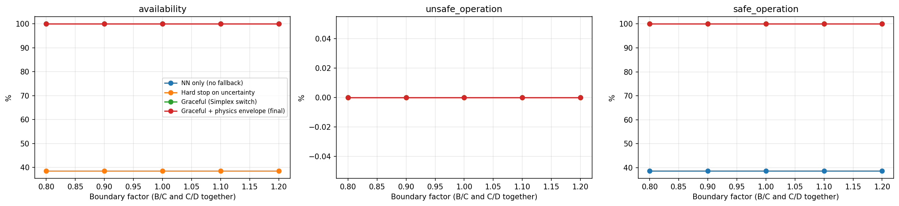{width=90%}

**Figure 23.** Policy metrics when both boundaries are scaled together. All curves are flat on the real data.

## 5.7 Policy comparison

Table 7 compares the four policies. Without the fallback, 100.0% of unseen-fault decision steps are diagnosed as a known fault without any warning; with the final design, 0.0%. Stopping on every uncertain prediction causes 61.5% downtime at 1 hp and 42.0% at 2 hp; the final design causes 0.0% at both loads. Over five seeds, hard-stop downtime is 56.3 ± 9.3% (1 hp) and 33.1 ± 7.0% (2 hp), and final-design downtime is 0.0 ± 0.0% at both. Individual networks are not all equally safe: silent misdiagnoses average 5.2 ± 9.4% of 1 hp steps for the final design across seeds, with 0.0% for the main run and the ensemble.

**Table 7.** Policy comparison (main run, seed 42). The known 1 hp accuracy is the same network for every policy.

| **Policy**                              | **Known 1 hp acc.** | **Safe operation (unseen 1 hp)** | **Silent failure (unseen 1 hp)** | **Downtime 1 hp** | **Downtime 2 hp** | **False fallback (known 2 hp)** |
|------------------|---------|----------|----------|---------|---------|----------|
| NN only (no fallback)                   | 100.0%              | 0.0%                             | 100.0%                           | 0.0%              | 0.0%              | \-                              |
| Hard stop on uncertainty                | 100.0%              | 100.0%                           | 0.0%                             | 61.5%             | 42.0%             | 25.4%                           |
| Graceful (Simplex switch)               | 100.0%              | 100.0%                           | 0.0%                             | 0.0%              | 0.0%              | 25.4%                           |
| **Graceful + physics envelope (final)** | **100.0%**          | **100.0%**                       | **0.0%**                         | **0.0%**          | **0.0%**          | **25.4%**                       |

**Table 8.** Metrics in the language of the original proposal: main run, five-seed mean ± standard deviation, and ensemble.

| **Proposal metric**                                 | **Main run**  | **5 seeds**               | **Ensemble**  |
|---------------------------|-------------|-------------------|--------------|
| Known-fault classification accuracy                 | 100.0%        | 100.0 ± 0.0%              | 100.0%        |
| Safe-operation rate on unseen faults (final design) | 100.0%        | 91.5 ± 15.3%              | 100.0%        |
| Same, without fallback (NN only)                    | 0.0%          | 0.0 ± 0.0%                | 0.0%          |
| Downtime, hard stop (1 hp / 2 hp)                   | 61.5% / 42.0% | 56.3 ± 9.3% / 33.1 ± 7.0% | 61.4% / 45.7% |
| Downtime, final design (1 hp / 2 hp)                | 0.0% / 0.0%   | 0.0 ± 0.0% / 0.0 ± 0.0%   | 0.0% / 0.0%   |
| False fallback rate (known 2 hp)                    | 25.4%         | 14.1 ± 8.8%               | 30.2%         |

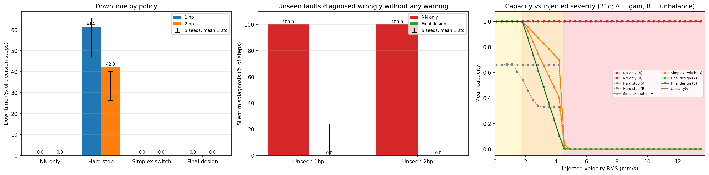{width=90%}

**Figure 24.** Downtime by policy (left), unseen faults diagnosed wrongly without any warning (middle), and mean capacity against injected velocity (right; scenarios A = gain, B = unbalance).

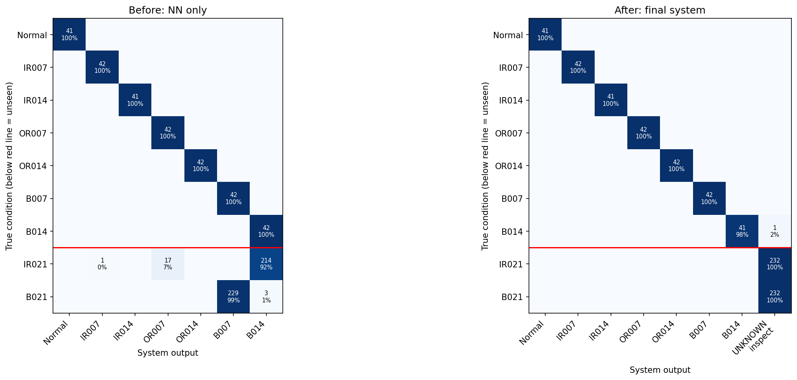{width=90%}

**Figure 25.** Decision-step confusion matrices. Left: NN only, where unseen IR021 is called B014 (92%) and unseen B021 is called B007 (99%). Right: final system, where all unseen steps are reported as unknown condition, inspect.

## 5.8 Robustness to load change and to dangerous zones

At 2 hp the trigger raised false fallbacks on 25.4% of known-class steps (about 50% for IR007, IR014 and B014, 23% for OR014, about 5% for Normal, and none for OR007 and B007). The final design nevertheless kept 100.0% availability, because the physics layer reads only vibration velocity, which does not change meaningfully with load (right panel of Figure 26): the same alarm costs nothing under the final design, while the hard-stop policy converts each false fallback into lost capacity.

Because real data never reached Zones C and D, we injected two scenarios into real recordings: an amplitude gain (A) and an added unbalance component at 1x rotation frequency (B). Increasing signal amplitude left the network\'s margin unchanged because the input is normalised, and the network alone kept running in 100.0% of Zone D steps. The final design ran in 0.0% of Zone D steps in both scenarios and never stopped outside Zone D (0.0% / 0.0%), while stopping on uncertainty caused 34.6% / 53.1% unnecessary stops. Switching to the physics controller only when the network is uncertain left trusted predictions at full capacity until the danger limit: the mean capacity just below the C/D boundary was 58.1% / 52.8%, followed by an abrupt drop. Keeping the physics envelope always active removes this cliff (7.0% / 9.2%). This is why it is the final design.

**Table 9.** Fault-injection results, scenario A (gain) / scenario B (unbalance at 1x).

| **Policy**                              | **Running in Zone D** | **Capacity just below C/D** |
|-----------------------------|--------------------|------------------------|
| NN only (no fallback)                   | 100.0% / 100.0%       | 100.0% / 100.0%             |
| Hard stop on uncertainty                | 0.0% / 0.0%           | 55.5% / 48.1%               |
| Graceful (Simplex switch)               | 0.0% / 0.0%           | 58.1% / 52.8%               |
| **Graceful + physics envelope (final)** | **0.0% / 0.0%**       | **7.0% / 9.2%**             |

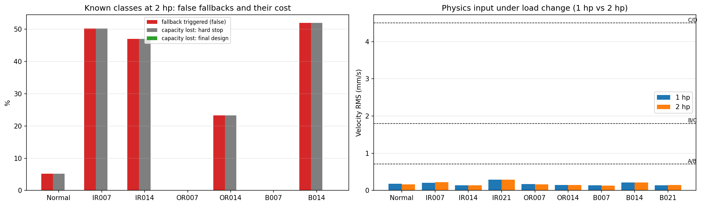{width=90%}

**Figure 26.** Known classes at 2 hp: false fallbacks and the capacity lost under the hard-stop and final policies (left), and the physics input at 1 hp and 2 hp against the zone boundaries (right).

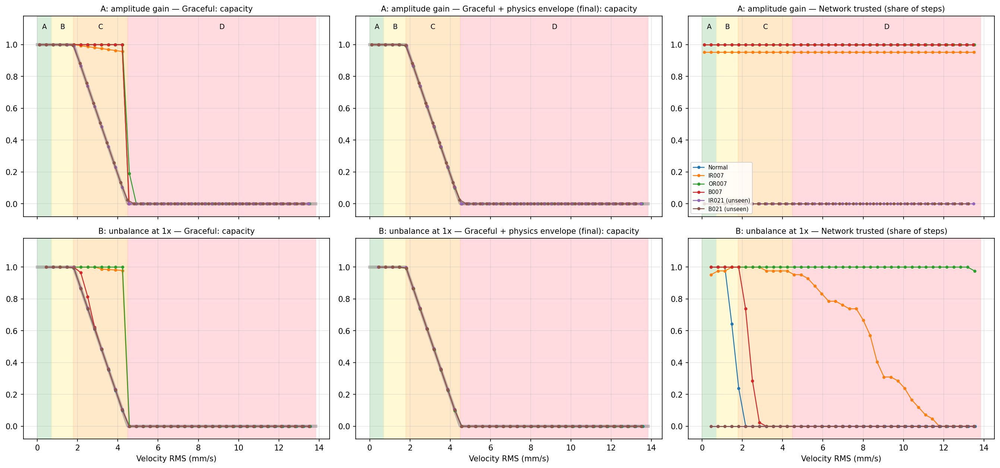{width=90%}

**Figure 27.** Fault injection. Rows: amplitude gain (A) and unbalance at 1x (B). Columns: capacity of the Simplex-switch policy, capacity of the final design, and the share of steps in which the network is trusted.

# 6. Discussion

**What the results show.** A network alone fails in the way the introduction predicted: it assigned every unseen-fault step to a wrong known class. IR021 became B014 and B021 became B007, which is a fault family or size error, not a random one. An uncertainty trigger removes those silent failures, and the cost of acting on it depends entirely on what happens when it fires. A hard stop turns each alarm into downtime. The final design turns an alarm into a diagnosis report (\"unknown condition, inspect\") and leaves the capacity to the physics envelope.

**Why the physics layer is independent of the network.** The load-sensitivity result is the strongest argument for this separation. The uncertainty score reacts to the change from 1 hp to 2 hp, but the velocity does not. Letting the network set capacity would pass that sensitivity on to production; letting only velocity set capacity does not.

**What the results do not show.** On the real recordings the physics layer never acted, because all velocities were in Zone A. The 0.0% downtime of the final design on real data therefore reflects that the machine was mechanically healthy by the ISO measure, and the benefit over a hard stop is the avoided false alarms, not any derating. The behaviour in Zones C and D is demonstrated by function tests and fault injection, which are simulations on real recordings, not real severe faults. Safe-operation figures treat the ISO boundary as the definition of unsafe, which is a modelling assumption.

# 7. Limitations

-   **Load sensitivity.** The uncertainty score is also sensitive to operating conditions: 27.9% of correctly classified 2 hp windows were flagged, and aggregation does not remove it. Training on several loads is the natural remedy and was not tested.

-   **Real data stayed in Zone A.** ISO broadband velocity cannot see these seeded bearing faults, so the physics layer\'s derating and stopping were tested only by function tests and fault injection.

-   **ISO values are a reference.** The Class I values are used by analogy; the CWRU motor is below the scope of ISO 10816-3, and real deployment would need the machine\'s own limits.

-   **Seed dependence.** Single networks vary widely (65.7% to 98.1% unseen detection). The ensemble removes this for the unseen classes tested but increases load-induced false fallbacks (30.2% at 2 hp).

-   **Scope of evidence.** One dataset, one rig, two unseen classes, and about 45 test windows per class; percentages carry real uncertainty. Results show the approach works on this benchmark, not that it generalises.

# 8. Conclusion and Future Work

A machine can stay safe under an unseen fault without the system diagnosing it. On the CWRU benchmark, separating capacity control (a physics envelope keyed to ISO velocity zones) from diagnosis (a CNN with a margin-based trust flag) removed silent misdiagnoses of the unseen faults without the downtime that a hard stop causes, and kept working when a change in load disturbed the uncertainty score. The contribution is this separation of machine safety from diagnosis correctness, together with an honest account of where it was and was not tested.

Future work: (1) validate on additional vibration datasets, including a multi-condition bearing set and run-to-failure data, where velocity actually reaches higher zones; (2) add a second physics indicator that can see bearing faults, such as high-frequency band RMS, with limits set against a healthy baseline; (3) replace the ISO reference values with real manufacturer limits; (4) train on several loads for load-aware uncertainty calibration; and (5) rotate which classes are held out as unseen to test that results do not depend on IR021 and B021.


# Appendix A. Code and Data Availability

All code, the executed notebook, figures and saved result files are in the project repository: <`r params$repo_url`>.

| Report part | Notebook section (`ML4.ipynb`) | Main output files |
|---|---|---|
| §3 Dataset and preprocessing | Phase A (Steps 1–14) | `artifacts/raw_signal_stats.csv`, `artifacts/normalization_params.json`, `artifacts/phaseA_dataset.npz`, figures `A*.png` |
| §4.2–4.3, §5.1–5.2 Detector and uncertainty | Phase B (Steps 15–27) | `artifacts/fault_cnn_1d.keras`, `artifacts/uncertainty_thresholds.json`, `artifacts/uncertainty_summary.csv`, figures `B*.png` |
| §5.3, §5.5 Logit margin, aggregation, 2 hp | Phase B+ (B+.1–B+.8) | `artifacts/uncertainty_thresholds_extended.json`, `artifacts/multiwindow_aggregation.csv`, `artifacts/extended_score_comparison.csv`, figures `Bplus_*.png` |
| §4.4–4.5, §5.6–5.8 Physics envelope, policies, fault injection | Phase C (Steps 28–31c) | `artifacts/phaseC_results.json`, `artifacts/phaseC_*.csv`, figures `C*.png` |
| §5.4 Seed variation and ensemble | Robustness (multi-seed, ensemble) | `artifacts/multiseed_*.csv/json`, `artifacts/ensemble_*.csv/json`, figures `R_*.png` |
| §5.7, §6–7 Final tables, confusion, limitations | Phase D (D1–D9) | `artifacts/phaseD_*.csv/md`, figures `D4_*.png`, `D5_*.png` |

Raw data: CWRU Bearing Data Center [11], 12 kHz drive-end files 98, 106, 170, 131, 198, 119, 186, 210, 223 (1 hp) and 99, 107, 171, 132, 199, 120, 187, 211, 224 (2 hp). The notebook downloads them automatically; the normal-baseline files (98, 99) are resampled from 48 kHz to 12 kHz.

# Appendix B. Key Tables Read Directly from the Saved Results

The tables below are not typed by hand: they are read from the CSV files in `artifacts/` when this document is knitted, so each number can be traced to a file.

**Table B1.** Final policy comparison (`artifacts/phaseD_final_policy_table.csv`).

```{r tab-policy}
kable(art("phaseD_final_policy_table.csv"))
```

**Table B2.** Proposal metrics: main run, five seeds and ensemble (`artifacts/phaseD_proposal_metrics.csv`).

```{r tab-proposal}
kable(art("phaseD_proposal_metrics.csv"))
```

**Table B3.** Multi-seed summary (`artifacts/multiseed_summary.csv`).

```{r tab-seeds}
ms <- art("multiseed_summary.csv")
names(ms)[1] <- "Measure"
kable(ms[, c(1, ncol(ms))], col.names = c("Measure", "Mean ± std over 5 seeds"))
```

**Table B4.** Fault-injection summary (`artifacts/phaseC_fault_injection_summary.csv`).

```{r tab-injection}
fi <- art("phaseC_fault_injection_summary.csv")
num <- vapply(fi, is.numeric, logical(1))
fi[num] <- lapply(fi[num], function(x) round(x, 3))
kable(fi)
```

# References

\[1\] G. Mu, C.-L. Liu and J. Chen, \"Integrating physical knowledge for generative-based zero-shot learning models in process fault diagnosis,\" Reliability Engineering & System Safety, vol. 258, Art. no. 110852, 2025, doi: 10.1016/j.ress.2025.110852.

\[2\] J. Cen, B. Zhao, X. Liu, H. Huang, D. Chen, H. Huang and K. Chen, \"An intelligent compound fault diagnosis method using generalized zero-shot model of bearing,\" Measurement Science and Technology, vol. 35, no. 9, Art. no. 096134, 2024, doi: 10.1088/1361-6501/ad5900.

\[3\] Y. Huang, M. Zhao, X. Liu, X. Xiang, M. Liu and J. Xie, \"Zero-shot bearing fault diagnosis under varying conditions based on prototypical vision transformers,\" Engineering Research Express, vol. 7, no. 4, Art. no. 045554, 2025, doi: 10.1088/2631-8695/ae154c.

\[4\] B. Yang and H. Sun, \"A zero-shot learning fault diagnosis method of rolling bearing based on extended semantic information under unknown conditions,\" Journal of the Brazilian Society of Mechanical Sciences and Engineering, vol. 45, Art. no. 35, 2023, doi: 10.1007/s40430-022-03965-2.

\[5\] Y. Qin, H. Liu, Y. Wang and Y. Mao, \"Inverse physics-informed neural networks for digital twin-based bearing fault diagnosis under imbalanced samples,\" Knowledge-Based Systems, vol. 292, Art. no. 111641, 2024, doi: 10.1016/j.knosys.2024.111641.

\[6\] S. Shen, H. Lu, M. Sadoughi, C. Hu, V. Nemani, A. Thelen, K. Webster, M. Darr, J. Sidon and S. Kenny, \"A physics-informed deep learning approach for bearing fault detection,\" Engineering Applications of Artificial Intelligence, vol. 103, Art. no. 104295, 2021, doi: 10.1016/j.engappai.2021.104295.

\[7\] Z. Xu, K. Zhao, J. Wang and M. Bashir, \"Physics-informed probabilistic deep network with interpretable mechanism for trustworthy mechanical fault diagnosis,\" Advanced Engineering Informatics, vol. 62, Art. no. 102806, 2024, doi: 10.1016/j.aei.2024.102806.

\[8\] T. Han and Y.-F. Li, \"Out-of-distribution detection-assisted trustworthy machinery fault diagnosis approach with uncertainty-aware deep ensembles,\" Reliability Engineering & System Safety, vol. 226, Art. no. 108648, 2022, doi: 10.1016/j.ress.2022.108648.

\[9\] T. Zeng, H. Jiang, X. Wang, Y. Bai and Z. Yi, \"An uncertainty decomposition-based automated out-of-distribution detection framework for trustworthy machinery fault diagnosis,\" Measurement Science and Technology, vol. 36, no. 8, Art. no. 085121, 2025, doi: 10.1088/1361-6501/adfcf8.

\[10\] S. Sheikhi, U. Mehmood, S. Bak, S. A. Smolka and S. D. Stoller, \"The black-box simplex architecture for runtime assurance of multi-agent CPS,\" Innovations in Systems and Software Engineering, vol. 21, no. 2, pp. 619–634, 2025, doi: 10.1007/s11334-024-00553-6.

\[11\] Case Western Reserve University Bearing Data Center, \"Bearing data center,\" \[Online\]. Available: https://engineering.case.edu/bearingdatacenter

\[12\] ISO 10816-1:1995, Mechanical vibration — Evaluation of machine vibration by measurements on non-rotating parts — Part 1: General guidelines, International Organization for Standardization, Geneva, 1995; and ISO 10816-3:2009, Part 3: Industrial machines with nominal power above 15 kW and nominal speeds between 120 r/min and 15 000 r/min when measured in situ, 2009.

\[13\] A. D. Ames, S. Coogan, M. Egerstedt, G. Notomista, K. Sreenath and P. Tabuada, \"Control barrier functions: Theory and applications,\" in Proc. 18th European Control Conference (ECC), Naples, Italy, 2019, pp. 3420–3431, doi: 10.23919/ECC.2019.8796030.

\[14\] B. Lakshminarayanan, A. Pritzel and C. Blundell, \"Simple and scalable predictive uncertainty estimation using deep ensembles,\" in Advances in Neural Information Processing Systems (NeurIPS), vol. 30, 2017, pp. 6402–6413.

\[15\] E. B. Wilson, \"Probable inference, the law of succession, and statistical inference,\" Journal of the American Statistical Association, vol. 22, no. 158, pp. 209–212, 1927, doi: 10.1080/01621459.1927.10502953.

\[16\] W. A. Smith and R. B. Randall, \"Rolling element bearing diagnostics using the Case Western Reserve University data: A benchmark study,\" Mechanical Systems and Signal Processing, vols. 64–65, pp. 100–131, 2015, doi: 10.1016/j.ymssp.2015.04.021.
